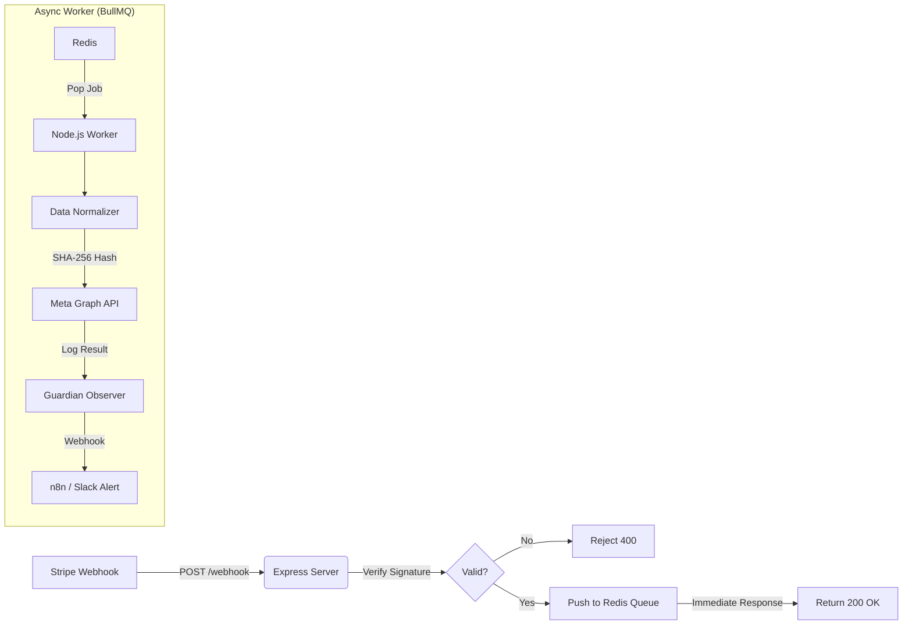

# Enterprise CAPI Gateway (Node.js + BullMQ) 🛡️

A high-performance, fault-tolerant **Server-Side Tracking Gateway** connecting Stripe Webhooks to Meta Conversions API (CAPI).

Designed for high-volume E-commerce brands requiring **100% data accuracy**, **zero event loss**, and **sub-50ms webhook latency**.

---

## 🚀 Why Node.js + BullMQ?
While simple scripts work for low volume, Enterprise AdTech requires robust concurrency handling. This architecture uses **Redis-backed Queues** to decouple ingestion from processing.

1.  **Zero-Blocking Ingestion:** The Express server accepts the webhook, validates the signature, and pushes it to Redis in **<10ms**. It replies `200 OK` instantly, preventing Stripe timeouts.
2.  **Fault Tolerance:** If the Meta API goes down (500 Error) or Rate Limits (429), **BullMQ** automatically holds the job and retries with **Exponential Backoff** (2s, 4s, 8s).
3.  **Data Persistence:** Events are stored in Redis RAM. If the server crashes, the queue survives.

---

## 🏗️ Architecture



---

## 🛠️ Tech Stack
*   **Runtime:** Node.js (v18+)
*   **Language:** TypeScript (Strict Typing)
*   **Server:** Express.js
*   **Queue:** BullMQ (Redis)
*   **SDK:** Official `facebook-nodejs-business-sdk`
*   **Observability:** Custom "Guardian" Logger -> n8n

---

## 🔑 Key Features

### 1. Advanced Deduplication
We generate a deterministic `event_id` based on the Stripe Payment Intent ID:
```typescript
const eventId = `purchase_${stripe_id}`;
```
This allows Meta to merge this server event with the Browser Pixel event, ensuring **100% Attribution** without double-counting revenue.

### 2. Privacy Compliance (SHA-256)
Before data leaves the secure worker environment, all PII (Email, Phone) is normalized and hashed:
*   **Email:** Trimmed, lowercased, SHA-256.
*   **Phone:** Strip symbols, remove leading zeros, SHA-256.

### 3. "Guardian" Observability
The system is transparent. Every successful transmission (or final failure) is sent to an external **n8n webhook**, creating a real-time audit log in Google Sheets or Slack.

---

## ⚙️ Setup & Installation

### 1. Prerequisites
*   Node.js v18+
*   Redis (Running on `localhost:6379` or via Docker)

### 2. Install Dependencies
```bash
npm install
```

### 3. Environment Variables
Create a `.env` file:
```bash
# Meta / Facebook
META_ACCESS_TOKEN=your_token
META_PIXEL_ID=your_pixel_id

# Stripe
STRIPE_SECRET_KEY=sk_test_...
STRIPE_WEBHOOK_SECRET=whsec_...

# Infrastructure
REDIS_HOST=localhost
REDIS_PORT=6379
N8N_WEBHOOK_URL=https://your-n8n-instance.com/webhook/...
```

### 4. Run the System
You need two terminals (or use a process manager like PM2):

**Terminal 1 (Server):**
```bash
npm run dev
```

**Terminal 2 (Worker):**
```bash
npm run worker
```

---

## 🧪 Testing
Use the Stripe CLI to trigger a mock payment:
```bash
stripe trigger payment_intent.succeeded
```

**Expected Output:**
1.  **Server:** `📥 Webhook Enqueued` (Instantly)
2.  **Worker:** `🔨 Processing Job...` -> `🚀 Sending to Meta...` -> `🛡️ Guardian Log Sent`

---

## 📄 License
MIT